# Data model and ERD (B1.2)

**Status: APPROVED by the owner 2026-11-19.** Approved, so B2.1 may build exactly this (SKILLS Database Standards; TASKS B1.2). After approval, B2.1 builds exactly this; later changes are new migrations that cite a change to this document.

Scope: Sprints 1 and 2 (MVP). Sources: **BE** = `3-Backend-Requirements.md`, **OVR** = `1-Overview-and-Sprints.md`, **SPEC** = `6-Functional-Workflow-Specification.md` (s11.2 binding for stock movements per GAP-C07), **GAP** = `PROJECT_GAPS_AND_ACTIONS.md`, **SKILLS** = `SKILLS.md`, **OQ-n** = owner decisions of 2026-11-19 (`TASKS.md` / `.claude/STATE.md`). Companion: `docs/PERMISSIONS.md` (B1.1). Decisions are in section 11 (permission-side ones in the permission document); nothing remains open.

## Owner decisions (2026-11-19)

The owner approved this document on 2026-11-19 and accepted every recommendation except where noted. Detail in section 11.4.

- **E3** No overage on receipt; surplus via the Sprint 4 found-stock adjustment.
- **E4** Split resolutions of one shortfall are allowed.
- **E10** `full_name` and `phone` required; `email` optional (differs from the recommendation).
- **E12** Quantities are `numeric(12,3)` everywhere.
- **E21** The ordered 5-rule dispatch header-status precedence in section 11.4, as written.
- **P3, P9, P19, P20** are in `docs/PERMISSIONS.md`.

## 1. Decisions this model implements

| Decision | Effect on the model | Source |
|---|---|---|
| Stock is a quantity per SKU per location; no unit, serial or barcode tables | `inventory_stockbalance` only. Every ledger row carries a stable source reference and line ID so an optional `unit_id` column can be added later by a new migration. | GAP-C02; BE s14 |
| Stored buckets per SKU per location: `on_hand`, `reserved`, `quarantined` (outside on hand, unsellable). `available = on_hand - reserved`, computed, never stored | Three numeric(12,3) columns with CHECK constraints. | OQ-18; SPEC s11.1-11.2 |
| In transit is derived: open dispatch lines (`dispatched - accepted - resolved`); the sender keeps that quantity in `reserved` | No in-transit column. A read query and an index on line status. | OQ-18 |
| Rejected or short quantity stays reserved at the sender, flagged as a discrepancy (Under investigation); resolved by return, loss or damage with a mandatory note | `transfers_discrepancy` and `transfers_discrepancyresolution`. | OQ-18; GAP-C08; SPEC s11.3 |
| Price is a central price list, one row per SKU, not on the item; set by SA or a `manage_prices` holder; not negative; the sale reads from it | `inventory_price` (section 5). Replaces "price from the item" in B6.1. | OQ-19; GAP-M08 |
| One stock service for every stock change | All balance and ledger writes go through it (section 8). | BE s11; TASKS B4.3 |
| Ledger and audit append-only | Model, queryset and database guards (section 7). | BE s9; SKILLS |
| Custom user model from the first migration; immutable, never-reused login ID | `accounts_user` (section 3). | SPEC s12.2; SKILLS |
| Money `Decimal(12,2)` GHS; timestamps timezone-aware (stored UTC, shown Africa/Accra) | All money columns `numeric(12,2)`; all times `timestamptz`. UTC storage is "proposed" in SKILLS: E14. | SKILLS:97; BE s11 |

## 2. Conventions

- Tables are named `<app>_<model>` (Django default). Apps follow the README layout. Apps with no tables in Sprints 1-2: `branch_access` (Sprint 5), `approvals` (Sprint 4), `notifications` (Sprint 4), `reports` (read-only queries only).
- Internal primary keys: `bigint` identity. Public references are separate unique columns (section 3, E2). Framework tables (sessions, migrations, content types) are not modelled here. `django.contrib.auth` Group and Permission tables exist but are unused: the project uses its own roles and grants.
- Audit fields on editable records: `created_at`, `created_by`, `updated_at`, `updated_by` (BE s3.2; SKILLS). Abbreviated "audit fields" below.
- Quantities: **`numeric(12,3)`** (Owner decision 2026-11-19, E12; BE s3.12:218, SKILLS:98) in every quantity column, ledger delta and balance, with the same CHECKs as before. The service enforces whole numbers unless the item's unit of measure allows decimals (default `piece`: whole).
- Nothing with history is deleted: foreign keys are `ON DELETE PROTECT` (no cascades); there is no delete path for users, branches, items, documents, ledger or audit rows.
- Active branch and role used in a request live in the session, validated on every request, and are copied onto the audit event and ledger rows.

## 3. Entities (22)

Legend: PK primary key, FK foreign key, UQ unique, NN not null, CK check.

### 3.1 accounts

**`accounts_user`** (custom user, `AbstractBaseUser`, `USERNAME_FIELD = login_id`; no Django `PermissionsMixin`)

| Field | Type | Rules |
|---|---|---|
| id | bigint PK | |
| login_id | varchar(12) NN UQ | `SA-0001` or `USR-0001`; CK `login_id ~ '^(SA\|USR)-[0-9]{4,}$'`; **immutable** (DB trigger rejects any UPDATE of this column); never reused: no user rows are ever deleted and ids come from sequences. |
| password | varchar(128) NN | Django hashed password (hasher pinned in settings). |
| full_name | varchar(150) NN | Owner decision 2026-11-19 (E10): `full_name` and `phone` are required. |
| phone | varchar(30) NN | Required (E10). |
| email | varchar(254) null | Optional (E10). |
| status | varchar(12) NN | CK in (`pending`, `active`, `suspended`, `deactivated`). Only `active` can log in (BE s2). |
| permanent_branch | FK `branches_branch` null | Null for Super Admins (system-wide) and Front Staff (pick at login). Warehouse Admin: the warehouse. Branch Admin: their branch. Service rule: required for WA and BA. |
| last_login | timestamptz null | |
| deactivated_at | timestamptz null | History is kept (BE s2). |
| audit fields | | `created_by` self-FK null (first user, `SA-0001`, is seeded). |

ID generator (B2.2): two PostgreSQL sequences, `accounts_sa_seq` and `accounts_usr_seq`, created in the first migration. `login_id` = prefix + `nextval` zero-padded to 4 digits (5+ digits after 9999). Sequences are non-transactional, so a rolled-back creation burns a number but can never reuse one. The prefix is fixed at creation by the user's first role; later role changes never change the ID (E8).

Indexes: UQ `login_id`; `(status)`; `(permanent_branch)`.

### 3.2 roles

**`roles_role`**: seeded by migration, four rows. `id` PK; `code` varchar(20) NN UQ, CK in (`super_admin`, `warehouse_admin`, `branch_admin`, `front_staff`); `name` varchar(50) NN.

**`roles_userrole`**: `id` PK; `user` FK NN; `role` FK NN; `assigned_by` FK user NN; `assigned_at` timestamptz NN; `revoked_by` FK user null; `revoked_at` timestamptz null (CK `(revoked_at IS NULL) = (revoked_by IS NULL)`; removing a role revokes the row, nothing is deleted). Partial UQ `(user, role) WHERE revoked_at IS NULL`. Sprints 1-2 give each user exactly one active row; the shape already allows several (Sprint 5). Only a Super Admin assigns or revokes (service rule, B2.4); both write an audit event.

**`roles_userpermissiongrant`** (per-person permissions)

| Field | Type | Rules |
|---|---|---|
| id | bigint PK | |
| user | FK NN | The grantee. |
| permission | varchar(20) NN | CK in (`receive_stock`, `manage_prices`, `apply_discount`). |
| granted_by | FK user NN | Must be a Super Admin (service rule). |
| granted_at | timestamptz NN | |
| revoked_by | FK user null | |
| revoked_at | timestamptz null | Revocation is the only permitted update; CK `(revoked_at IS NULL) = (revoked_by IS NULL)`. |

Partial UQ `(user, permission) WHERE revoked_at IS NULL` (one active grant). History of grants and revokes is kept.

### 3.3 branches

**`branches_branch`** (the warehouse and the branches: "each location holds its own balances", BE s2)

| Field | Type | Rules |
|---|---|---|
| id | bigint PK | |
| code | varchar(10) NN UQ | Public branch ID, e.g. `BR-001` (E2). |
| name | varchar(100) NN | UQ on `lower(name)`. |
| kind | varchar(10) NN | CK in (`warehouse`, `branch`). Partial UQ `(kind) WHERE kind = 'warehouse'`: exactly one central warehouse (E1). |
| location | varchar(200) | Address text. |
| contact | varchar(100) | Phone or contact name. |
| status | varchar(10) NN | CK in (`active`, `inactive`). Deactivation keeps history. |
| audit fields | | |

Seed (B2.5): the warehouse plus 3 branches.

### 3.4 inventory

In Sprints 1-2 an **item is one SKU** (the sellable configuration). The product/variant split with data migration is Sprint 3 (B15.1); nothing here blocks it: balances, ledger, sale lines and dispatch lines reference `item`, which becomes the variant.

**`inventory_brand`**: `id`; `name` varchar(100) NN, UQ on `lower(name)`. Managed list (BE s3.2). Seeded; managing endpoint not in B4.1: E20.

**`inventory_subtype`**: `id`; `category` varchar(20) NN CK in (`laptop`, `laptop_part`, `accessory`); `name` varchar(100) NN; UQ `(category, lower(name))`. Managed list; seeded: E20.

**`inventory_item`**

| Field | Type | Rules |
|---|---|---|
| id | bigint PK | |
| sku | varchar(40) NN UQ | System-generated or imported; never reused; immutable once used in a transaction (service rule plus DB trigger rejecting an UPDATE of `sku` once a ledger, receipt, dispatch or sale line references the item). Format: E2. |
| name | varchar(200) NN | |
| category | varchar(20) NN | CK in (`laptop`, `laptop_part`, `accessory`). |
| subtype | FK `inventory_subtype` NN | Must belong to `category` (service rule). |
| brand | FK `inventory_brand` NN | |
| model_name | varchar(100) NN | |
| mpn | varchar(100) NN | Manufacturer part number. |
| description | text | |
| condition | varchar(12) NN | CK in (`new`, `refurbished`, `used`). |
| uom | varchar(20) NN default `piece` | Decimals allowed only where the unit of measure allows; `piece` is whole numbers (E12, Owner decision 2026-11-19). |
| specs | jsonb NN default `{}` | The "key specs" of B4.1, validated against field definitions per category kept in code and served by the API (B4.1). Typed spec columns with filters are Sprint 3 (B12.1). |
| image_path / image_content_type / image_bytes | varchar / varchar / integer null | One image (B4.2); type and size enforced in the service; at least one image is required to activate. Several images: Sprint 3 table. |
| show_on_website | boolean NN default false | Used by the Sprint 9 API. |
| search_keywords | text | Alternative names and misspellings. |
| status | varchar(12) NN default `draft` | CK in (`draft`, `active`, `discontinued`). Only `active` can be received, dispatched or sold; `discontinued` stops new transactions, keeps history. |
| audit fields | | |

No `price` and no `cost` columns on the item (OQ-19; cost lives on receipt lines; the cost shown is the derived average, E7). Currency is the constant GHS, not a column. Tax category, warranty terms and supplier link are later sprints and are not added now.

Indexes: UQ `sku`; `(status)`; `(category, brand)`; trigram or `lower()` index on `name`, `model_name` and `sku` for search (B6.3, B9.1: results within about 2 seconds); UQ-style duplicate warning is a service query, not a constraint (BE s3.9).

**`inventory_stockbalance`** (the only mutable stock state; written only by the stock service)

| Field | Type | Rules |
|---|---|---|
| id | bigint PK | |
| item | FK NN | |
| location | FK `branches_branch` NN | Warehouse or branch. |
| on_hand | numeric(12,3) NN default 0 | CK `on_hand >= 0`. |
| reserved | numeric(12,3) NN default 0 | CK `reserved >= 0` and CK `reserved <= on_hand`. |
| quarantined | numeric(12,3) NN default 0 | CK `quarantined >= 0`. Outside on hand and unsellable (OQ-18). |
| reorder_level | numeric(12,3) null | Per location; drives low-stock (B7.1). CK `>= 0`. |
| bin_label | varchar(50) | Warehouse only, optional (BE s3.8). |
| updated_at | timestamptz NN | |

- UQ `(item, location)`.
- **available = on_hand - reserved**, computed in queries and in the stock service; never stored. Sale and dispatch require `available >= q`.
- **In transit is not here** (derived, section 4).
- Rows are created on first need by the service (ORM `bulk_create(ignore_conflicts=True)`, then lock; no raw SQL, SKILLS:77).
- Invariant (test and management check): for every `(item, location, bucket)`, the balance equals the sum of ledger `delta`.
- Indexes: UQ `(item, location)`; `(location)`; partial `(location) WHERE reorder_level IS NOT NULL AND on_hand - reserved <= reorder_level` for low stock.

**`inventory_price`** (price list, section 5)

### 3.5 warehouse

**`warehouse_goodsreceipt`** (GRN header)

| Field | Type | Rules |
|---|---|---|
| id | bigint PK | |
| reference | varchar(20) NN UQ | Public GRN number; generated column `'GRN-' \|\| lpad(id::text, 6, '0')` (E2). |
| location | FK `branches_branch` NN | CK via service: must be the warehouse. |
| supplier_name | varchar(150) NN | Free text in the MVP; supplier records in Sprint 9 (GAP-M07). |
| received_by | FK user NN | |
| received_at | timestamptz NN | |
| notes | text | |
| operation | FK `stock_ledger_operation` NN UQ | Ties the receipt to its idempotent operation. |

Receipts are never edited afterwards (no update path; corrections are Sprint 4 reversals).

**`warehouse_goodsreceiptline`**: `id`; `receipt` FK NN; `line_no` smallint NN; `item` FK NN; `quantity` numeric(12,3) NN CK `> 0`; `unit_cost` numeric(12,2) NN CK `>= 0` (mandatory: E18). UQ `(receipt, line_no)`. Cost is read by SA and WA only.

### 3.6 transfers (dispatches)

**`transfers_dispatch`**

| Field | Type | Rules |
|---|---|---|
| id | bigint PK | |
| reference | varchar(20) NN UQ | Generated `'DSP-' \|\| lpad(id::text, 6, '0')`. |
| kind | varchar(20) NN default `warehouse_dispatch` | CK in (`warehouse_dispatch`) now. Sprint 4 adds `branch_transfer` by a new migration widening the CK; the table, lines and discrepancy flow are reused (no rewrite). |
| origin | FK `branches_branch` NN | Sprints 1-2: the warehouse. |
| destination | FK `branches_branch` NN | A branch. CK `origin <> destination`. |
| status | varchar(24) NN | CK in (`in_transit`, `partially_received`, `completed`, `rejected`, `under_investigation`): the SPEC s5.4 / GAP-H05 words in use (`draft` and `dispatched` are not used, E11). Derived from the line statuses by one pure function (E21, Owner decision 2026-11-19), recomputed under the header lock after every change to a line. |
| reason | varchar(200) null | For Sprint 4 branch transfers; null for warehouse dispatches. |
| dispatched_by | FK user NN | |
| dispatched_at | timestamptz NN | |
| decided_by | FK user null | Receiving decision, once. |
| decided_at | timestamptz null | |
| decision_note | text | Note for partial; reason for reject (required by the service). |
| operation | FK `stock_ledger_operation` NN UQ | The dispatch operation. |
| receive_operation | FK `stock_ledger_operation` null UQ | The receiving decision operation (one decision per dispatch). |

CK `(decided_by IS NULL) = (decided_at IS NULL)`. Indexes: `(destination, status)` ("what is waiting at each branch", B5.4); `(origin, status)`; `(dispatched_at)`.

**`transfers_dispatchline`**

| Field | Type | Rules |
|---|---|---|
| id | bigint PK | Used as the ledger `source_line_id`. |
| dispatch | FK NN | |
| line_no | smallint NN | UQ `(dispatch, line_no)`. |
| item | FK NN | Active items only (service). |
| qty_dispatched | numeric(12,3) NN | CK `> 0`. |
| qty_received | numeric(12,3) null | Physically arrived; set by the receiving decision. |
| qty_accepted | numeric(12,3) null | Credited to the destination. |
| qty_rejected | numeric(12,3) null | Arrived but refused. |
| qty_resolved | numeric(12,3) NN default 0 | Sum of resolutions (section below), maintained by the stock service. |
| status | varchar(24) NN default `in_transit` | CK in (`in_transit`, `received` (fully accepted, closed), `under_investigation`, `resolved_returned`, `resolved_lost`, `resolved_damaged`, `resolved_mixed`). `resolved_mixed` exists only if partial resolutions are allowed (E4). |

Constraints: CK `qty_received IS NULL OR qty_received BETWEEN 0 AND qty_dispatched` (no overage: E3); CK `qty_accepted IS NULL OR (qty_accepted >= 0 AND qty_accepted <= qty_received)`; CK `qty_rejected IS NULL OR qty_rejected = qty_received - qty_accepted`; CK `qty_resolved >= 0 AND qty_resolved <= qty_dispatched - COALESCE(qty_accepted, 0)`; CK `(qty_received IS NULL) = (qty_accepted IS NULL) AND (qty_accepted IS NULL) = (qty_rejected IS NULL)`.

Derived quantities (never stored):
- short (never arrived) = `qty_dispatched - qty_received`
- unresolved = `qty_dispatched - qty_accepted - qty_resolved`
- **in transit (open)** = `qty_dispatched - COALESCE(qty_accepted, 0) - qty_resolved` over lines with status `in_transit` or `under_investigation` (OQ-18); the dashboard shows the total, with the Under investigation part as a separate figure (E5 answered).

Indexes: `(dispatch)`; `(item)`; partial `(status) WHERE status IN ('in_transit','under_investigation')` for the in-transit and discrepancy queries.

**`transfers_discrepancy`** (one per line that has a shortfall or rejection)

| Field | Type | Rules |
|---|---|---|
| id | bigint PK | |
| dispatch_line | FK NN UQ | |
| qty_short | numeric(12,3) NN | `dispatched - received`. CK `>= 0`. |
| qty_rejected | numeric(12,3) NN | CK `>= 0`. CK `qty_short + qty_rejected > 0`. |
| note | text NN | The receiver's note or rejection reason. |
| flagged_by / flagged_at | FK user NN / timestamptz NN | |
| status | varchar(10) NN | CK in (`open`, `resolved`). |

**`transfers_discrepancyresolution`**

| Field | Type | Rules |
|---|---|---|
| id | bigint PK | Used as the ledger `source_line_id` for resolution entries. |
| discrepancy | FK NN | |
| outcome | varchar(10) NN | CK in (`return`, `loss`, `damage`). |
| quantity | numeric(12,3) NN | CK `> 0`; the sum per discrepancy may not exceed its `qty_short + qty_rejected` (service, under the line lock; trigger as a backstop). |
| note | text NN | CK `length(btrim(note)) > 0`: mandatory. |
| resolved_by | FK user NN | An admin role (service, B2.4). |
| role_used | varchar(20) NN | |
| branch_context | FK `branches_branch` null | Active branch at the time. |
| resolved_at | timestamptz NN | |
| operation | FK `stock_ledger_operation` NN UQ | |

Append-only (no update or delete path).

### 3.7 sales

**`sales_paymentmethod`**: `id`; `code` varchar(20) NN UQ; `name` varchar(50) NN; `is_active` boolean NN. Seeded: cash, mobile money, card ("configurable", BE s6). Split payments (Sprint 7) add a `sales_salepayment` table and migrate the single method then.

**`sales_sale`**

| Field | Type | Rules |
|---|---|---|
| id | bigint PK | |
| reference | varchar(20) NN UQ | Generated `'SAL-' \|\| lpad(id::text, 6, '0')`. |
| branch | FK `branches_branch` NN | Active branch at the time of sale; a branch, not the warehouse. |
| sold_by | FK user NN | |
| role_used | varchar(20) NN | |
| payment_method | FK NN | |
| total | numeric(12,2) NN | CK `>= 0`; equals the sum of line totals (service; DB check by constraint trigger or test). |
| status | varchar(10) NN default `completed` | CK in (`completed`, `cancelled`, `refunded`, `exchanged`) (GAP-H05). Sprints 1-2 use the first two. |
| sold_at | timestamptz NN | |
| cancelled_by | FK user null | |
| cancelled_at | timestamptz null | |
| cancel_reason | text null | CK `status <> 'cancelled' OR length(btrim(cancel_reason)) > 0`; CK `(status = 'cancelled') = (cancelled_at IS NOT NULL)` while only the two statuses exist. |
| operation | FK `stock_ledger_operation` NN UQ | |
| cancel_operation | FK `stock_ledger_operation` null UQ | |

A completed sale is never edited; only the cancel transition is allowed, through the service. Indexes: `(branch, sold_at DESC)` (sales list, B6.2); `(sold_by, sold_at)`; `(status)`. Customer details, receipts and discounts are Sprint 6.

**`sales_saleline`**: `id` (ledger `source_line_id`); `sale` FK NN; `line_no` smallint NN, UQ `(sale, line_no)`; `item` FK NN; `quantity` numeric(12,3) NN CK `> 0`; `unit_price` numeric(12,2) NN CK `>= 0` (**copied from the price list at sale time**, never recomputed); `line_total` numeric(12,2) NN CK `line_total = quantity * unit_price`. Index `(item)`.

### 3.8 stock_ledger

**`stock_ledger_operation`** (idempotency record: one row per stock-changing service call)

| Field | Type | Rules |
|---|---|---|
| id | bigint PK | |
| idempotency_key | uuid NN | Client `Idempotency-Key` header. For system-initiated operations (CSV import rows) a deterministic key is derived. |
| operation_type | varchar(24) NN | CK in (`supplier_receipt`, `dispatch`, `receive_decision`, `discrepancy_resolution`, `sale`, `sale_cancel`, `opening_balance_import`). |
| actor | FK user NN | |
| request_hash | char(64) NN | SHA-256 of the canonical request body. |
| (no source columns) | | The operation is inserted before its document exists, and the table is append-only, so it carries no pointer to the document. The link is the other way round: each document holds a UQ FK to its operation (`goods_receipt.operation`, `dispatch.operation`, `dispatch.receive_operation`, `discrepancyresolution.operation`, `sale.operation`, `sale.cancel_operation`). Ledger rows carry `source_type`, `source_id`, `source_ref`, `source_line_id`. |
| metadata | jsonb NN default `{}` | Set at insert only. For an import: file name, row count, file hash, and the result summary, all computed by the dry-run validation before the operation row is inserted. |
| created_at | timestamptz NN | |

UQ `(actor, operation_type, idempotency_key)`. A repeat with the same key and the same `request_hash` returns the original result; the same key with a different hash is an error naming the field (409). Keys are kept forever (E13).

**Replay rebuilds the response; it does not store it.** The operation row and its document are inserted in one transaction, so a committed operation always has its document. On replay the service finds the document through the FK by `operation_type` (table above) and returns it through the normal read serializer for the caller (same actor, so the same cost rule). Import replays return the stored summary from `metadata` plus the ledger rows of that operation. No response body is stored, so nothing sensitive is duplicated.

**`stock_ledger_entry`** (append-only: one row per bucket change)

| Field | Type | Rules |
|---|---|---|
| id | bigint PK | Monotonic; total order of movements. |
| operation | FK NN | |
| idempotency_key | uuid NN | Copy of the operation's key, so the row is self-contained. |
| occurred_at | timestamptz NN | |
| location | FK `branches_branch` NN | |
| item | FK NN | |
| bucket | varchar(12) NN | CK in (`on_hand`, `reserved`, `quarantined`). |
| delta | numeric(12,3) NN | CK `delta <> 0`. |
| balance_after | numeric(12,3) NN | Bucket value after the change. CK `>= 0`. |
| reason | varchar(30) NN | See section 6 (`supplier_receipt`, `opening_balance`, `dispatch_reserve`, `dispatch_received`, `discrepancy_return`, `discrepancy_loss`, `discrepancy_damage`, `sale`, `sale_cancel`). |
| source_type | varchar(30) NN | `goods_receipt`, `dispatch`, `discrepancy_resolution`, `sale`, `import_batch`. |
| source_id | bigint NN | The id of the source document; for an import, which has no document, the id of the operation. |
| source_ref | varchar(30) NN | Stable public reference (`GRN-000012`, `DSP-000004`, `SAL-000230`, `IMP-000003`). |
| source_line_id | bigint NN | The line id (`goods_receipt_line`, `dispatch_line`, `sale_line`; for a resolution the `discrepancyresolution` id; for an import the CSV row number). Stable key for a future `unit_id` link (GAP-C02). |
| actor | FK user NN | |
| role_used | varchar(20) NN | |
| branch_context | FK `branches_branch` null | Active branch. |
| note | text | Resolution note, cancel reason. |
| reverses | FK self null | Set on compensating rows (sale cancel): the original entry. Partial UQ `(reverses) WHERE reverses IS NOT NULL`: an entry is reversed at most once. |

Constraints: UQ `(operation, source_line_id, location, item, bucket, reason)`: replay cannot double-post. A future `unit_id` is a new nullable column; no unit table exists.
Indexes: `(item, location, occurred_at)`; `(location, occurred_at)`; `(source_type, source_id)`; `(idempotency_key)`; `(actor, occurred_at)`.

### 3.9 audit

**`audit_auditevent`** (append-only)

| Field | Type | Rules |
|---|---|---|
| id | bigint PK | |
| occurred_at | timestamptz NN | |
| actor | FK user null | Null only for failed logins of unknown IDs. |
| actor_login_id | varchar(12) | Snapshot, so the line stays readable. |
| role_used | varchar(20) | Role and workspace (BE s9). |
| branch | FK `branches_branch` null | Active branch. |
| action | varchar(60) NN | Dotted code, e.g. `auth.login`, `auth.login_failed`, `branch.switched`, `user.created`, `user.permission_granted`, `item.updated`, `price.changed`, `grn.confirmed`, `dispatch.created`, `dispatch.received`, `discrepancy.flagged`, `discrepancy.resolved`, `sale.completed`, `sale.cancelled`, `import.committed`. |
| reference_type / reference_id | varchar(30) / bigint null | |
| previous_value / new_value | jsonb null | Before and after for changes (cost fields included only here; the audit read endpoint applies the same cost rule: never to BA or FS). |
| self_approved | boolean NN default false | True when a Super Admin approved their own request (OVR s1 #3). |
| ip_address | inet null | |
| user_agent | varchar(300) | Device. |
| request_id | uuid null | Correlates with logs. |
| operation | FK `stock_ledger_operation` null | Set for events written by a stock service call (receipt, dispatch, receiving, resolution, sale, cancel, import); null otherwise. Lets an audit line be joined to its ledger rows. |

Indexes: `(occurred_at DESC)`; `(actor, occurred_at)`; `(branch, occurred_at)`; `(action, occurred_at)`; `(reference_type, reference_id)`. The login log and rate limit (B2.3) use `auth.login` and `auth.login_failed` events: no separate table and no cache dependency (thresholds: P18). Retention is open (GAP-M10).

## 4. Derived values (never stored)

| Value | Definition |
|---|---|
| available | `on_hand - reserved` per `(item, location)` |
| in transit (open) | over `transfers_dispatchline` with status `in_transit` or `under_investigation`: `qty_dispatched - COALESCE(qty_accepted, 0) - qty_resolved` (OQ-18) |
| waiting at a branch | dispatches with `destination = branch` and status `in_transit` |
| short / unresolved | section 3.6 |
| low stock | `available <= reorder_level` |
| cross-branch lookup | `available` per `branches_branch` of kind `branch` for one item, returning branch name and quantity only (P14) |

## 5. Price list (OQ-19, GAP-M08)

**`inventory_price`**

| Field | Type | Rules |
|---|---|---|
| id | bigint PK | |
| item | FK NN | |
| scope | varchar(10) NN default `central` | CK in (`central`, `branch`). Sprints 1-2 only ever write `central`. |
| branch | FK `branches_branch` null | CK `(scope = 'central' AND branch IS NULL) OR (scope = 'branch' AND branch IS NOT NULL)`. |
| amount | numeric(12,2) NN | CK `>= 0` (never negative). |
| effective_from | timestamptz NN default now | Moves forward on each change. |
| effective_to | timestamptz null | Null = current. Unused in Sprints 1-2. |
| set_by | FK user NN | Super Admin or a `manage_prices` holder (service rule). |
| audit fields | | |

Partial UQ `(item) WHERE scope = 'central' AND effective_to IS NULL`: **one current central row per SKU**. In Sprints 1-2 nothing sets `effective_to`, so this is exactly one row per SKU. Partial UQ `(item, branch) WHERE scope = 'branch' AND effective_to IS NULL`.

How it extends **without a rewrite**:
- **Sprints 1-2:** the service updates the single central row in place (`amount`, `effective_from`, `set_by`) and writes an `price.changed` audit event with the old and new amount, so the old values are never lost.
- **Branch overrides (Sprint 6, B27.1):** insert rows with `scope = 'branch'` and the branch. The sale looks up the active branch's current row, else the central row. No schema change; the CHECK and indexes already allow it.
- **Price history (Sprint 5, B23.1):** the service stops updating in place: it sets `effective_to` on the current row and inserts the new row. The unique index already allows many closed rows and one open row. "Old price, new price, who, when" are the consecutive rows (`set_by`, `effective_from`); changes made in Sprints 1-2 can be backfilled from the audit events.
- **Named price lists (Sprint 6, B26.1):** add a nullable `price_list` FK and widen the CK; `central` is the default list.
- Sale lines copy the amount at sale time, so later changes never alter a past sale.
- A selling price is required (BE s3.2:55), so an item needs a price row to be activated or sold (E16 answered).
- A below-cost warning (Sprint 5) compares against average cost, derived from receipt lines and the ledger (E7).

## 6. Movement table (SPEC s11.2, OQ-18)

Every row is one service call = one `stock_ledger_operation`, one transaction, locks in the order of section 8, one ledger row per bucket change listed, one audit event. `q` is a line quantity, `a` the accepted quantity. S = sender (warehouse), D = destination branch.

| Operation | Pre-check | Bucket deltas | Ledger rows (location, bucket, delta, reason) | Audit action |
|---|---|---|---|---|
| **Supplier receipt** (B5.1) | Item Active; qty > 0; unit cost given | Warehouse `on_hand` +q | 1 per line: (warehouse, on_hand, +q, `supplier_receipt`) | `grn.confirmed` |
| **Opening balance import** (B6.4) | Valid row; location exists | Location `on_hand` +q | 1 per row: (location, on_hand, +q, `opening_balance`), `source_line_id` = CSV row number | `import.committed` |
| **Dispatch** (B5.2) | S `available >= q` | S `reserved` +q (so S available -q); line `in_transit` | 1 per line: (S, reserved, +q, `dispatch_reserve`) | `dispatch.created` |
| **Receipt: accepted a** (B5.3) | Dispatch `in_transit`; caller allowed; `a <= received <= dispatched` | S `reserved` -a; S `on_hand` -a; D `on_hand` +a | 3 per line with `a > 0`: (S, reserved, -a, `dispatch_received`), (S, on_hand, -a, `dispatch_received`), (D, on_hand, +a, `dispatch_received`) | `dispatch.received` |
| **Receipt: rejected or short** (B5.3) | Same | No bucket change. The unaccepted quantity `dispatched - a` stays in S `reserved`. Line becomes `under_investigation` and a `transfers_discrepancy` row is created. | None | `dispatch.received`, `discrepancy.flagged` |
| **Receipt: approve all** | `a = dispatched` | As "accepted a" with `a = dispatched`; line `received` | 3 per line | `dispatch.received` |
| **Resolution: return** (B7.3) | Line `under_investigation`; `q <=` unresolved; note | S `reserved` -q (S available +q; `on_hand` unchanged) | 1: (S, reserved, -q, `discrepancy_return`) | `discrepancy.resolved` |
| **Resolution: loss** | Same | S `reserved` -q; S `on_hand` -q | 2: (S, reserved, -q, `discrepancy_loss`), (S, on_hand, -q, `discrepancy_loss`) | `discrepancy.resolved` |
| **Resolution: damage** | Same | S `reserved` -q; S `on_hand` -q; D `quarantined` +q | 3: (S, reserved, -q), (S, on_hand, -q), (D, quarantined, +q), all `discrepancy_damage` | `discrepancy.resolved` |
| **Sale** (B6.1) | Item Active with a price; branch `available >= q` for every line | Branch `on_hand` -q | 1 per line: (branch, on_hand, -q, `sale`) | `sale.completed` |
| **Cancel sale** (B6.5) | Sale `completed`; reason | Branch `on_hand` +q per line (E6) | 1 per original line: (branch, on_hand, +q, `sale_cancel`), `reverses` = the original sale entry | `sale.cancelled` |

Worked example (SPEC s5.3, dispatch 100, 95 accepted, 5 short). Warehouse starts on_hand 200, reserved 0:
1. Dispatch 100: warehouse on_hand 200, reserved 100, available 100. Line `in_transit` (derived in transit 100).
2. Receipt, `received = 95`, `accepted = 95`: warehouse reserved 5, on_hand 105, available 100. Branch on_hand +95. Line `under_investigation`; discrepancy short 5; in transit (open) 5, still in warehouse reserved.
3a. Return 5: warehouse reserved 0, on_hand 105, available 105.
3b. Or loss 5: warehouse reserved 0, on_hand 100, available 100.
3c. Or damage 5: warehouse reserved 0, on_hand 100; branch quarantined +5.

Rules shared by every row: balances never go below zero (CHECKs plus service pre-check, with a plain message naming the field); `reserved <= on_hand` holds after every step; ledger deltas of one bucket sum to its balance.

## 7. Append-only enforcement (ledger and audit)

Four layers, each tested (B4.5, B8.2; SKILLS "audit immutability"):
1. **Model:** `save()` on an existing row raises; `delete()` raises.
2. **Manager and queryset:** `update()`, `delete()`, `bulk_update()` and `bulk_create(update_conflicts=True)` raise; only `create()` and `bulk_create()` exist.
3. **Database triggers:** `BEFORE UPDATE OR DELETE` and `BEFORE TRUNCATE` triggers on `stock_ledger_entry`, `stock_ledger_operation` and `audit_auditevent` raise an exception for every role, the table owner included. A test attempts raw SQL `UPDATE`, `DELETE` and `TRUNCATE` and expects failure.
4. **Privileges:** where the host allows (DevOps s7), the runtime role holds only `SELECT` and `INSERT` on those tables and migrations run as a separate owner role. Depends on hosting (OQ-20 on hold): E15.

Other DB guards in the same style: `accounts_user.login_id` immutable (trigger); `inventory_item.sku` immutable once referenced (trigger); balance writes only inside the stock service (E9).

## 8. Stock service, locking order and idempotency keys

**One service** (`stock_ledger.services`) performs every change to `inventory_stockbalance` and writes every ledger row. No view, serializer, signal, admin action or management command touches balances; an architecture test greps for writes outside it, and a database guard is proposed (E9).

Each public function: `transaction.atomic`; docstring naming the rule it enforces and the audit event it writes; steps as follows.

**Locking order** (global, to prevent deadlocks):
1. Insert the `stock_ledger_operation` row (unique key `(actor, operation_type, idempotency_key)`); on conflict return the rebuilt result (same hash) or fail (different hash). No row locks yet.
2. Lock the **document header first**. For every dispatch-related operation (create a dispatch: the new header row is inserted, then locked; receiving decision; discrepancy resolution) that is the `transfers_dispatch` row. For a resolution the dispatch id is read from the line without a lock, then the header is locked, then the line is re-read. For a sale cancel: the `sales_sale` row. A call touches one document type.
3. Lock the document's **lines ordered by `id` ascending**, then any `transfers_discrepancy` rows of those lines ordered by `id`.
4. Ensure the needed `inventory_stockbalance` rows exist (ORM `bulk_create(ignore_conflicts=True)`), then lock them with `select_for_update` **ordered by `(location_id, item_id)` ascending**, all in one query. One balance row holds the three buckets, so one lock covers any bucket of that item and location.
5. Re-check the rules against the locked values (available, reserved, status, quantities).
6. Insert ledger rows, update balances, update line statuses, **recompute the header status from all of its lines** (still under the header lock, so two concurrent resolutions of different lines of one dispatch serialise at step 2 and the header always reflects both), insert the audit event; commit.

Cross-checking sales: a sale with no pre-existing document locks nothing at steps 2-3 and goes straight to step 4.

Locks never go from balances back to documents; headers come before lines, lines before balances; balances are always in `(location_id, item_id)` order. A sale of the last unit by two clients: the second blocks at step 4, then fails the check at step 5 with a plain "only N available" message. Tested with concurrent transactions (B4.5, B6.6).

**Idempotency keys**
- Every mutating stock endpoint requires an `Idempotency-Key` header (UUID): warehouse receipt, dispatch, receiving decision, discrepancy resolution, sale, cancel sale, CSV import commit.
- Scope `(actor, operation_type, key)`, kept forever (E13). Same key and body: the original result is rebuilt from the operation and its document (section 3.8; no new rows). Same key, different body: 409 with a plain message.
- Natural uniqueness backs it up: one receiving decision per dispatch (`receive_operation` UQ and status check under the lock); one cancel per sale (`cancel_operation` UQ); one reversal per ledger entry (`reverses` UQ); ledger UQ `(operation, source_line_id, location, item, bucket, reason)`.
- System operations derive their key: CSV import commit uses the file hash plus the actor; rows use the row number as `source_line_id`.

## 9. Constraints summary (database level)

Non-negative quantities and `reserved <= on_hand` on balances; line quantity bounds on dispatch lines; `quantity > 0` on receipt, dispatch and sale lines; `delta <> 0` and `balance_after >= 0` on ledger rows; money `>= 0` and `numeric(12,2)`; unique constraints on references, `login_id`, `sku`, one balance per `(item, location)`, one warehouse, one current central price per SKU; status CHECKs on every enumerated column; mandatory-note CHECKs on resolutions and cancellations; append-only triggers; immutability triggers on `login_id` and referenced `sku`.

## 10. Mermaid ERD

```mermaid
erDiagram
    accounts_user ||--o{ roles_userrole : has
    roles_role ||--o{ roles_userrole : grants
    accounts_user ||--o{ roles_userpermissiongrant : holds
    branches_branch ||--o{ accounts_user : "permanent branch"
    inventory_brand ||--o{ inventory_item : classifies
    inventory_subtype ||--o{ inventory_item : classifies
    inventory_item ||--o{ inventory_price : "priced by"
    branches_branch |o--o{ inventory_price : "branch override (S6)"
    inventory_item ||--o{ inventory_stockbalance : "counted in"
    branches_branch ||--o{ inventory_stockbalance : holds
    stock_ledger_operation ||--o{ stock_ledger_entry : writes
    inventory_item ||--o{ stock_ledger_entry : moves
    branches_branch ||--o{ stock_ledger_entry : at
    accounts_user ||--o{ stock_ledger_entry : actor
    stock_ledger_entry |o--o| stock_ledger_entry : reverses
    warehouse_goodsreceipt ||--|{ warehouse_goodsreceiptline : contains
    inventory_item ||--o{ warehouse_goodsreceiptline : received
    branches_branch ||--o{ warehouse_goodsreceipt : "received at"
    stock_ledger_operation ||--o| warehouse_goodsreceipt : creates
    transfers_dispatch ||--|{ transfers_dispatchline : contains
    inventory_item ||--o{ transfers_dispatchline : dispatched
    branches_branch ||--o{ transfers_dispatch : origin
    branches_branch ||--o{ transfers_dispatch : destination
    stock_ledger_operation ||--o| transfers_dispatch : creates
    transfers_dispatchline ||--o| transfers_discrepancy : flags
    transfers_discrepancy ||--o{ transfers_discrepancyresolution : "resolved by"
    stock_ledger_operation ||--o| transfers_discrepancyresolution : creates
    branches_branch ||--o{ sales_sale : "sold at"
    accounts_user ||--o{ sales_sale : "sold by"
    sales_paymentmethod ||--o{ sales_sale : "paid with"
    sales_sale ||--|{ sales_saleline : contains
    inventory_item ||--o{ sales_saleline : sold
    stock_ledger_operation ||--o| sales_sale : creates
    accounts_user ||--o{ audit_auditevent : performs
    stock_ledger_operation |o--o{ audit_auditevent : "audited by"
    branches_branch |o--o{ audit_auditevent : context

    accounts_user {
        bigint id PK
        varchar login_id UK "SA-0001 or USR-0001, immutable"
        varchar status
        bigint permanent_branch FK
    }
    roles_role {
        bigint id PK
        varchar code UK
    }
    roles_userrole {
        bigint user FK
        bigint role FK
    }
    roles_userpermissiongrant {
        bigint user FK
        varchar permission "receive_stock manage_prices apply_discount"
        timestamptz revoked_at
    }
    branches_branch {
        bigint id PK
        varchar code UK
        varchar kind "warehouse or branch"
        varchar status
    }
    inventory_item {
        bigint id PK
        varchar sku UK
        varchar status "draft active discontinued"
        jsonb specs
    }
    inventory_price {
        bigint item FK
        varchar scope "central now, branch in S6"
        bigint branch FK "null for central"
        numeric amount "12,2 GHS"
        timestamptz effective_from
        timestamptz effective_to
    }
    inventory_stockbalance {
        bigint item FK
        bigint location FK
        numeric on_hand "CK >= 0"
        numeric reserved "CK >= 0 and <= on_hand"
        numeric quarantined "CK >= 0"
    }
    stock_ledger_operation {
        bigint id PK
        uuid idempotency_key
        varchar operation_type
        varchar source_type
        bigint source_id
    }
    stock_ledger_entry {
        bigint id PK
        varchar bucket "on_hand reserved quarantined"
        numeric delta
        varchar reason
        varchar source_ref
        bigint source_line_id
        uuid idempotency_key
        bigint reverses FK
    }
    warehouse_goodsreceipt {
        bigint id PK
        varchar reference UK
        varchar supplier_name
    }
    warehouse_goodsreceiptline {
        bigint receipt FK
        bigint item FK
        numeric quantity
        numeric unit_cost "12,2 GHS"
    }
    transfers_dispatch {
        bigint id PK
        varchar reference UK
        varchar kind
        varchar status
    }
    transfers_dispatchline {
        bigint id PK
        numeric qty_dispatched
        numeric qty_received
        numeric qty_accepted
        numeric qty_rejected
        numeric qty_resolved
        varchar status "in_transit under_investigation resolved"
    }
    transfers_discrepancy {
        bigint dispatch_line FK
        numeric qty_short
        numeric qty_rejected
        varchar status
    }
    transfers_discrepancyresolution {
        bigint discrepancy FK
        varchar outcome "return loss damage"
        numeric quantity
        text note "mandatory"
    }
    sales_paymentmethod {
        bigint id PK
        varchar code UK
    }
    sales_sale {
        bigint id PK
        varchar reference UK
        varchar status "completed cancelled"
        numeric total "12,2 GHS"
    }
    sales_saleline {
        bigint sale FK
        bigint item FK
        numeric quantity
        numeric unit_price "copied from price list"
    }
    audit_auditevent {
        bigint id PK
        varchar action
        jsonb previous_value
        jsonb new_value
        boolean self_approved
    }
```

## 11. Decisions and open questions

Citations were checked against the inventory files (`file:line`).

### 11.1 Answered by the documents

| Ref | Answer | Source |
|---|---|---|
| E5 | The dashboard in-transit total includes quantity Under investigation (derived: dispatched - accepted - resolved). | OQ-18 |
| E6 | Cancelling a sale posts a compensating reversal back to the branch `on_hand`. | BE s6:257, s7:264 |
| E7 | Cost is the **average cost**, derived from receipt lines and the ledger; it is not a stored item column and not "latest receipt cost". SA and WA only. | BE s3.7:188; SKILLS:144 |
| E8 | The login ID never changes, whatever the role later. | BE s2:19 |
| E11 | A dispatch is confirmed in one step; no Draft. | FE 4.7:74; BE s5:238-239 |
| E16 | A selling price is required, so activation needs one (same as P5). | BE s3.2:55; OVR s1 #7; FE 4.3:56 |
| E18 | Unit cost is mandatory on every receipt line. | FE 4.6:70; BE s12:316 |
| E19 | Damage credits `quarantined` at the destination as OQ-18 says, for rejected and short quantity alike. | OQ-18 |

### 11.2 Technical decisions (team)

| Ref | Decision |
|---|---|
| E1 | One location table (`branches_branch`) with a `kind` column; exactly one warehouse. |
| E2 | `bigint` identity keys; public references generated from the key (`GRN-000012`, `DSP-000004`, `SAL-000230`, `IMP-000003`, branch `BR-001`). |
| E9 | Database guard: balance rows can be written only inside the stock service (a trigger requires a transaction-local setting that only the service sets), on top of the architecture test. |
| E13 | Idempotency key scope is actor plus operation type; kept forever. |
| E14 | Timestamps stored in UTC, shown Africa/Accra. |
| E17 | New SKUs are `SKU-` plus the key; imported SKUs are accepted if unique. |
| E20 | Brands and sub-types are seeded by data migration now; a management endpoint comes later with approval. |

### 11.3 Later

| Ref | Item |
|---|---|
| E15 | Separate owner and runtime database roles and REVOKE of UPDATE/DELETE: when hosting is chosen (O1.5; hosting is on hold, OQ-20). Triggers (section 7, layer 3) are the guard until then. |

### 11.4 Owner decisions 2026-11-19

| Ref | Question | Owner decision 2026-11-19 |
|---|---|---|
| E21 | How is the dispatch header `status` derived from its lines? SPEC s5.3:247 uses "under investigation" for ANY open shortfall, not only "nothing arrived". | Accepted as written. Ordered rule, first match wins, using only SPEC s5.4 words: (1) no receiving decision yet: `in_transit`. (2) Decision recorded and any line still `under_investigation` (any open shortfall or rejection, including mixed lines): `under_investigation`. (3) No open discrepancy and every line `received` (fully accepted): `completed`. (4) No open discrepancy, nothing accepted on any line, every discrepancy resolved by return: `rejected` (a fully rejected dispatch that is then returned ends as `rejected`). (5) No open discrepancy otherwise (some accepted, remainder resolved by return, loss or damage): `partially_received` if any line is not fully accepted, else `completed`. Mixed lines (some rejected, some never arrived, nothing accepted) stay `under_investigation` until every line is resolved, then rule 4 or 5 applies. Recomputed under the header lock. |
| E3 | May a branch report **more** than was dispatched (overage)? | Accepted: no overage (`received <= dispatched`); surplus goes through the Sprint 4 found-stock adjustment. |
| E4 | May one shortfall be resolved in parts (for example 3 returned and 2 lost)? | Accepted: yes, several resolutions per discrepancy; line `resolved_mixed` when outcomes differ. |
| E10 | Required identity fields on a user beyond name (SPEC s2.1). | `full_name` and `phone` required; `email` optional. |
| E12 | Quantity type (BE s3.12:218, SKILLS:98). | `numeric(12,3)` for every quantity. |
