# ERD (B1.2)

**Approved by owner 2026-11-23.**

Status: **approved** (owner, 2026-11-23), with the day-1 fixes FIX-1, FIX-2, FIX-3 and FIX-9 folded in (TASKS "FIX LOG"). OQ-4 to OQ-19 are answered as proposed.
Scope: Sprint 1 and 2 tables. Later tables (notifications, branch access, approvals, adjustments, price history, customers, suppliers, split payments, product/variant) are listed in section 6 and not modelled now.
Sources: BE s2, s3, s4, s5, s6, s9; SPEC s11.2 and s5.4; SKILLS "Database Standards"; DEC = workspace CLAUDE.md "Decisions already made". Items marked **DECISION** are design choices the owner confirmed by approving this file.

## 1. Conventions

- Primary keys: `bigint` identity (internal). Public references (login ID, SKU, GRN, dispatch, sale) are separate unique text columns. Formats (OQ-18, approved): `SA-0001`, `USR-0001`, `GRN-000001`, `TRF-000001`, `SAL-000001`, `RES-000001` (one sequence per type); SKU system-generated `SKU-000001` or imported unchanged.
- Money: `numeric(12,2)`, GHS only, `CHECK >= 0`. Exception: average cost and the sale-line cost snapshot are `numeric(14,4)` (OQ-16); the API shows 2 dp. Quantities: `integer`, `CHECK` as listed (whole numbers, unit of measure is "piece" in the MVP).
- All timestamps `timestamptz`, stored in UTC, shown as Africa/Accra.
- Editable tables carry `created_by`, `created_at`, `updated_by`, `updated_at`.
- Nothing with history is deleted: users, locations and items are deactivated or discontinued, never removed.
- Append-only tables (ledger, audit, login log, switch log, dispatch resolutions): inserts only. See section 4.
- **Status codes (FIX-5, owner-approved 2026-11-23, contract v0.1.1):** stored and sent as snake_case codes, mapped 1:1 to the SKILLS "Status vocabularies" words shown on screens. A test (`tests/test_openapi_contract.py`) checks the diagram, the contract enums and this table agree.

  | Object | Code = word |
  |---|---|
  | Account (`users.status`) | `active` = Active, `pending_activation` = Pending activation, `suspended` = Suspended, `deactivated` = Deactivated |
  | Item (`items.status`) | `draft` = Draft, `active` = Active, `discontinued` = Discontinued (final: no move back, OQ-20) |
  | Transfer (`dispatches.status`) | `in_transit` = In transit, `completed` = Completed, `partially_received` = Partially received, `rejected` = Rejected (MVP subset, OQ-17) |
  | Sale (`sales.status`) | `completed` = Completed, `cancelled` = Cancelled, `refunded` = Refunded, `exchanged` = Exchanged |

## 2. Diagram

```mermaid
erDiagram
    users ||--o{ user_roles : has
    roles ||--o{ user_roles : grants
    users ||--o{ user_permissions : "per-person grants"
    locations ||--o{ users : "permanent location (non-front-staff)"
    users ||--o{ login_log : attempts
    users ||--o{ switch_log : "branch switches"
    locations ||--o{ switch_log : "from / to"

    categories ||--o{ subtypes : has
    categories ||--o{ items : classifies
    subtypes ||--o{ items : classifies
    brands ||--o{ items : "brand"
    items ||--|| item_prices : "one price row per SKU"
    items ||--o| item_costs : "average cost (SA, WA only)"

    locations ||--o{ stock_balances : holds
    items ||--o{ stock_balances : "per SKU per location"
    stock_balances ||--o{ stock_movements : "bucket changes"
    users ||--o{ stock_movements : actor
    stock_movements |o--o| stock_movements : reverses

    goods_receipts ||--|{ goods_receipt_lines : has
    items ||--o{ goods_receipt_lines : received
    locations ||--o{ goods_receipts : "warehouse"

    dispatches ||--|{ dispatch_lines : has
    items ||--o{ dispatch_lines : sent
    locations ||--o{ dispatches : "origin / destination"
    dispatch_lines ||--o{ dispatch_resolutions : "shortfall outcomes"

    sales ||--|{ sale_lines : has
    items ||--o{ sale_lines : sold
    locations ||--o{ sales : "branch"
    payment_methods ||--o{ sales : "paid by"
    sales ||--o| sale_cancellations : "cancelled by"

    users ||--o{ audit_events : actor

    users {
        bigint id PK
        text login_id UK "SA-0001 or USR-0001, immutable"
        text full_name
        text password "Argon2 hash"
        text status "active, pending_activation, suspended, deactivated"
        boolean must_change_password "forced change at first login"
        timestamptz one_time_password_issued_at
        bigint permanent_location_id FK "null for front staff and SA"
        timestamptz last_login_at
        timestamptz created_at
        bigint created_by FK
        timestamptz updated_at
        bigint updated_by FK
    }
    login_id_sequences {
        text prefix PK "SA or USR"
        integer last_number "only ever increases"
    }
    roles {
        bigint id PK
        text code UK "super_admin, warehouse_admin, branch_admin, front_staff"
        text name
    }
    user_roles {
        bigint id PK
        bigint user_id FK
        bigint role_id FK
        timestamptz assigned_at
        bigint assigned_by FK
    }
    user_permissions {
        bigint id PK
        bigint user_id FK
        text permission "receive_stock, manage_prices, discount"
        timestamptz granted_at
        bigint granted_by FK
        timestamptz revoked_at "null while active"
        bigint revoked_by FK
    }
    locations {
        bigint id PK
        text kind "warehouse or branch"
        text code UK
        text name UK
        boolean is_active
        timestamptz created_at
        bigint created_by FK
        timestamptz updated_at
        bigint updated_by FK
    }
    login_log {
        bigint id PK
        text login_id_attempted
        bigint user_id FK "null if ID unknown"
        text event "login_success, login_failed, logout"
        text failure_reason
        inet ip
        text user_agent
        timestamptz at
    }
    switch_log {
        bigint id PK
        bigint user_id FK
        bigint from_location_id FK
        bigint to_location_id FK
        timestamptz at
    }
    categories {
        bigint id PK
        text name UK "Laptop, Laptop Part, Accessory"
    }
    subtypes {
        bigint id PK
        bigint category_id FK
        text name
    }
    brands {
        bigint id PK
        text name UK
        boolean is_active "false = cannot be chosen for new items (OQ-20)"
    }
    items {
        bigint id PK
        text sku UK "immutable once used"
        text name
        bigint category_id FK
        bigint subtype_id FK
        bigint brand_id FK
        text model_name
        text mpn
        text description
        text condition "new, refurbished, used"
        text grade "A, B, C or null"
        text unit_of_measure "piece"
        text status "draft, active, discontinued"
        jsonb key_specs "MVP key specs, typed columns in Sprint 3"
        text image "one image in MVP"
        boolean show_on_website
        text search_keywords
        timestamptz created_at
        bigint created_by FK
        timestamptz updated_at
        bigint updated_by FK
    }
    item_prices {
        bigint id PK
        bigint item_id FK "unique: one row per SKU"
        numeric selling_price "GHS, check >= 0"
        timestamptz updated_at
        bigint updated_by FK
    }
    item_costs {
        bigint item_id PK
        numeric average_cost "numeric(14,4), GHS, one per SKU across all locations (OQ-16); API shows 2 dp; never serialised for BA or FS"
        timestamptz updated_at
    }
    stock_balances {
        bigint id PK
        bigint location_id FK
        bigint item_id FK "unique with location_id"
        integer on_hand "check >= 0"
        integer reserved "check >= 0 and <= on_hand"
        integer quarantined "check >= 0"
        text bin_label "optional"
        integer reorder_level "optional, check >= 0"
        timestamptz updated_at
    }
    stock_movements {
        bigint id PK
        timestamptz created_at
        bigint location_id FK
        bigint item_id FK
        text bucket "on_hand, reserved, quarantined"
        integer quantity_delta "signed, never 0"
        integer balance_after "bucket value after this row"
        text movement_type "see section 3"
        text source_type "goods_receipt, dispatch, dispatch_resolution, sale, sale_cancellation, csv_import"
        bigint source_id "for csv_import: import_batches.id; source_line_id is the CSV row number"
        text source_ref "stable human reference e.g. GRN-000012"
        bigint source_line_id "stable line ID"
        uuid operation_id "groups the rows of one operation"
        bigint actor_id FK
        text actor_role
        bigint actor_location_id FK "active branch used"
        bigint reverses_movement_id FK "reversal rows only"
        text note
    }
    goods_receipts {
        bigint id PK
        text reference UK "GRN"
        bigint location_id FK "the warehouse"
        text supplier_name "free text in MVP"
        text notes
        timestamptz received_at
        bigint received_by FK
        uuid operation_id UK
    }
    goods_receipt_lines {
        bigint id PK
        bigint receipt_id FK
        bigint item_id FK
        integer quantity "check > 0"
        numeric unit_cost "GHS, check >= 0"
    }
    dispatches {
        bigint id PK
        text reference UK
        bigint origin_location_id FK
        bigint destination_location_id FK
        text status "in_transit, completed, partially_received, rejected"
        timestamptz dispatched_at
        bigint dispatched_by FK
        timestamptz received_at
        bigint received_by FK
        text receive_note
        uuid operation_id UK
    }
    dispatch_lines {
        bigint id PK
        bigint dispatch_id FK
        bigint item_id FK "unique with dispatch_id"
        integer qty_sent "check > 0"
        integer qty_received "physical count, null until received"
        integer qty_accepted "credited to destination"
        integer qty_rejected
        text line_note "required if accepted < sent"
    }
    dispatch_resolutions {
        bigint id PK
        text reference UK
        bigint dispatch_line_id FK
        text action "return_to_sender, confirm_loss, record_damage"
        integer quantity "check > 0"
        text note "mandatory, not blank"
        bigint resolved_by FK
        text resolved_role
        timestamptz resolved_at
        boolean is_self_approval
        uuid operation_id UK
    }
    payment_methods {
        bigint id PK
        text code UK "cash, mobile_money, card"
        text name
        boolean is_active
    }
    sales {
        bigint id PK
        text reference UK
        bigint location_id FK "branch at time of sale"
        bigint staff_id FK
        text status "completed, cancelled, refunded, exchanged"
        bigint payment_method_id FK
        numeric total "GHS"
        timestamptz sold_at
        uuid operation_id UK
    }
    sale_lines {
        bigint id PK
        bigint sale_id FK
        bigint item_id FK
        integer quantity "check > 0"
        numeric unit_price "price at time of sale"
        numeric line_total
        numeric unit_cost_snapshot "numeric(14,4), average_cost copied at sale time (OQ-16); visible to SA and WA only; API shows 2 dp"
    }
    sale_cancellations {
        bigint id PK
        bigint sale_id FK "unique"
        text reason "mandatory"
        bigint cancelled_by FK
        text cancelled_role
        timestamptz cancelled_at
        uuid operation_id UK
    }
    audit_events {
        bigint id PK
        timestamptz occurred_at
        bigint actor_id FK "null for unknown login"
        text actor_login_id "copy, survives anything"
        text actor_role
        bigint location_id FK "active branch"
        text action "open-ended list"
        text target_type
        text target_ref
        jsonb before_values
        jsonb after_values
        boolean is_self_approval
        inet ip
        text user_agent
        uuid operation_id
    }
    idempotency_keys {
        bigint id PK
        uuid key "client-supplied"
        text scope "endpoint or action name"
        bigint actor_id FK
        text request_hash
        integer response_status
        jsonb response_body
        timestamptz created_at
    }
    import_batches {
        bigint id PK
        text reference UK "IMP-000001"
        text kind "items_and_opening_stock"
        bigint location_id FK
        text file_name
        integer row_count
        bigint imported_by FK
        timestamptz imported_at
        uuid operation_id UK
    }
```

## 3. Stock model (DEC, SPEC s11.2)

Stored per SKU per location in `stock_balances`: `on_hand`, `reserved`, `quarantined`. **Available = on_hand - reserved.** In transit is **derived** from open dispatch lines (status `in_transit`); the sender's quantity stays inside `reserved` until the receiving decision.
`quarantined` is a separate bucket (not part of on_hand and not available).

Every change is made by the one stock service. One ledger row per bucket changed. Rows (location, bucket, delta):

| Event (`movement_type`) | Rows written |
|---|---|
| `supplier_receipt` (GRN line of q) | warehouse on_hand +q |
| `opening_balance` (CSV import row) | location on_hand +q |
| `dispatch` (line of q) | origin reserved +q |
| `dispatch_receipt` (accepted a of sent q) | origin reserved -a; origin on_hand -a; destination on_hand +a. Rejected or short q-a stays reserved at the origin as an open discrepancy. |
| `resolution_return` (q) | origin reserved -q |
| `resolution_loss` (q) | origin reserved -q; origin on_hand -q |
| `resolution_damage` (q) | origin reserved -q; origin on_hand -q; destination quarantined +q |
| `sale` (line of q) | branch on_hand -q |
| `sale_cancellation` (line of q) | branch on_hand +q, `reverses_movement_id` = the original sale row |

Open discrepancy on a line = `qty_sent - qty_accepted - sum(resolution quantities)`; it can never go below 0 (checked under the line lock).
A branch-to-branch transfer (Sprint 4) reuses `dispatches` with a branch as origin; no new stock tables.

**Ledger columns for per-unit tracking later (GAP-C02):** every row has `source_type`, `source_id`, `source_ref`, `source_line_id`. A nullable `unit_id` link can be added later as a new column. No unit, barcode or serial tables now.

## 4. Integrity rules

- **One stock service** (`stock_ledger` app) is the only code that writes `stock_balances` or `stock_movements`. Other apps call it.
- **Atomic and locked:** `transaction.atomic`; rows locked with `select_for_update()` in one fixed order: ascending `(location_id, item_id)`. Missing balance rows are created with insert-on-conflict-do-nothing, then locked. A request that touches several rows locks them all first, then validates, then writes.
- **No negative stock** and `reserved <= on_hand`: `CHECK` constraints on `stock_balances`, plus service validation that returns a plain message naming the item and branch.
- **Idempotency:** every data-changing request carries an idempotency key. `idempotency_keys` has `UNIQUE (actor_id, scope, key)` and is always looked up by all three, so one user can never read another user's stored response. A repeat with the same key and the same `request_hash` returns the stored result; the same key with a different body returns `409 idempotency_conflict`. **Required B4.3 test:** user B replaying user A's key (same scope) never receives A's stored body (it is treated as B's own first use). Each business record also has a unique `operation_id`, and the ledger has `UNIQUE (source_type, source_id, source_line_id, movement_type, location_id, bucket)`, so a duplicate can never post twice. CSV opening-stock rows use `source_type = csv_import`, `source_id = import_batches.id`, `source_line_id` = row number, so this uniqueness holds for imports too. **Required stock-service test:** posting the same import batch row twice writes one ledger row.
- **Append-only (ledger, audit, login log, switch log, dispatch resolutions):** three layers. (1) Model and manager layer: no `update`, `delete`, `save` on existing rows (raises), with tests. (2) Database triggers that reject `UPDATE`, `DELETE` and `TRUNCATE`. (3) The application database role gets `INSERT` and `SELECT` only on these tables where the host setup allows a separate migration role. Corrections are new rows linked to the original (`reverses_movement_id`).
- **Single location rule:** a partial unique index allows only one `locations` row with `kind = 'warehouse'`.
- **Immutable login ID:** database trigger rejects any change to `users.login_id`; `login_id_sequences` only increases, so IDs are never reused. A user who is deactivated keeps the ID.
- **Prices:** one `item_prices` row per item, `CHECK selling_price >= 0`. Cost lives in `item_costs`, a separate table, so serializers for BA and FS cannot reach it by accident. **Required test (B4.x / Sprint 2 sales):** a sale line stores `unit_cost_snapshot` at 4 dp, the API shows 2 dp, and BA/FS responses contain neither `unit_cost_snapshot` nor `average_cost`.
- **Active branch** is held in the server-side session and copied into every ledger, audit and sale row.
- **Draft items** cannot appear in receipts, dispatches or sales (service check).
- **Dispatch line numbers:** `qty_accepted + qty_rejected <= qty_received <= qty_sent`; shortfall = `qty_sent - qty_accepted`. Over-delivery (received above sent) is rejected (OQ-17).
- **Login events:** every login success, failure and logout writes `login_log` (IP, device, reason; used for rate limiting and session history) and also one `audit_events` row.

## 5. Table notes

| Table | App | Notes |
|---|---|---|
| `users` | accounts | Custom user model from the first migration (`AUTH_USER_MODEL`), login field `login_id`. `must_change_password` is set by Super Admin create or reset (one-time password shown once, DEC C5) and cleared when the user sets their own. Front staff and SA have no `permanent_location_id`. |
| `login_id_sequences` | accounts | One row per prefix; read-increment under row lock when creating a user. |
| `roles`, `user_roles` | roles | Four fixed roles. Join table now so Sprint 5 multi-role needs no migration. |
| `user_permissions` | roles | Current and past grants (revoke keeps the row). Three codes. |
| `locations` | branches | Warehouse and branches in one table so balances, dispatches and ledger share one foreign key. |
| `login_log`, `switch_log` | accounts, branch_access | `switch_log` is the branch switch log; role switch columns come with Sprint 5. |
| `categories`, `subtypes`, `brands` | inventory | Managed lists (BE 3.12). `brands.is_active` (OQ-20): SA and WA add, rename and deactivate brands (never deleted); a deactivated brand stays on existing items and cannot be chosen for new items. Three categories: Laptop, Laptop Part, Accessory. Sub-type seeds (OQ-19): laptop sub-type = segment list in BE 3.3; parts and accessories use the BE 3.4 and 3.5 lists. |
| `items` | inventory | One row per SKU now. **DECISION:** MVP key specs are validated JSON (`key_specs`) driven by the category field definitions the API returns; typed columns replace it in Sprint 3. Sprint 3 adds a `products` table and `items.product_id` with a data migration (BE s12 Day 15). SKU is immutable once used in a transaction. |
| `item_prices` | inventory | One row per SKU (GAP-M08), extended in Sprint 5 and 6 (history, branch override). **OQ-21:** a row is not needed to activate an item; until the item has a price row **the sale service must refuse it** (B-sales, Sprint 2). Only SA or a Manage prices holder may write it (403 otherwise). |
| `item_costs` | inventory | One average per SKU across all locations, `numeric(14,4)` (OQ-16). |
| `stock_balances` | inventory | Unique `(location_id, item_id)`. `reorder_level` and `bin_label` live here (DEC C13, bin label). Low stock = `on_hand - reserved <= reorder_level`. |
| `stock_movements` | stock_ledger | The ledger. Never updated or deleted. |
| `idempotency_keys` | stock_ledger | **New table, not named in the plan:** needed for the idempotency rule (BE s11). `UNIQUE (actor_id, scope, key)`. Rows may be purged after a retention period (set with hosting, OQ-3). |
| `goods_receipts`, `goods_receipt_lines` | warehouse | Immutable once confirmed (BE s4). Supplier name free text now; supplier records Sprint 9 (GAP-M07). Invoice and delivery-note attachments and inspection/grading are later (Sprint 9). |
| `dispatches`, `dispatch_lines` | transfers | Status values in MVP: `in_transit`, `completed`, `partially_received`, `rejected` (SPEC s5.4 also lists draft and under investigation: OQ-17). Receiving fields live on the dispatch and its lines (one receiving decision per dispatch). |
| `dispatch_resolutions` | transfers | **New table:** one row per resolution action; append-only; note mandatory (CHECK `length(trim(note)) > 0`). |
| `import_batches` | inventory | **New table (FIX-9):** one row per committed CSV import; its `id` is the `source_id` of the `csv_import` ledger rows. Immutable. |
| `payment_methods` | sales | Configurable list (BE s6); seeded cash, mobile money, card. |
| `sales`, `sale_lines`, `sale_cancellations` | sales | Sales are never edited; only `status` moves to Cancelled through the cancel service, which inserts the cancellation row and the reversal ledger rows. Customer details, discounts, split payments are later sprints. `sale_lines.unit_cost_snapshot` copies the average cost for later margin reports (OQ-16). |
| `audit_events` | audit | Append-only, action list open-ended. `before_values` / `after_values` hold the previous and new values. Self-approval flagged. |
| Django built-ins | | `django_session`, `django_content_type`, `django_migrations`, `auth_permission`/`auth_group` come with `django.contrib.auth` (unused for business permissions; roles and permissions are our own tables). |

## 6. Not modelled now (later sprints)

Notifications (S4), adjustments and approvals (S4), branch access requests and temporary grants (S5), role switch log (S5), price history and branch price overrides (S5, S6), customers, discounts, split payments, daily close, refunds (S6, S7), suppliers, inspection and grading, API keys (S9), products/variants and multiple images (S3), warranty fields (S3), unit/barcode/serial tables (deferred, GAP-C02).

## 7. Open points

None for the ERD. OQ-16 to OQ-19 are approved and folded in above. Retention of logs and personal data is OQ-3 (decided).
